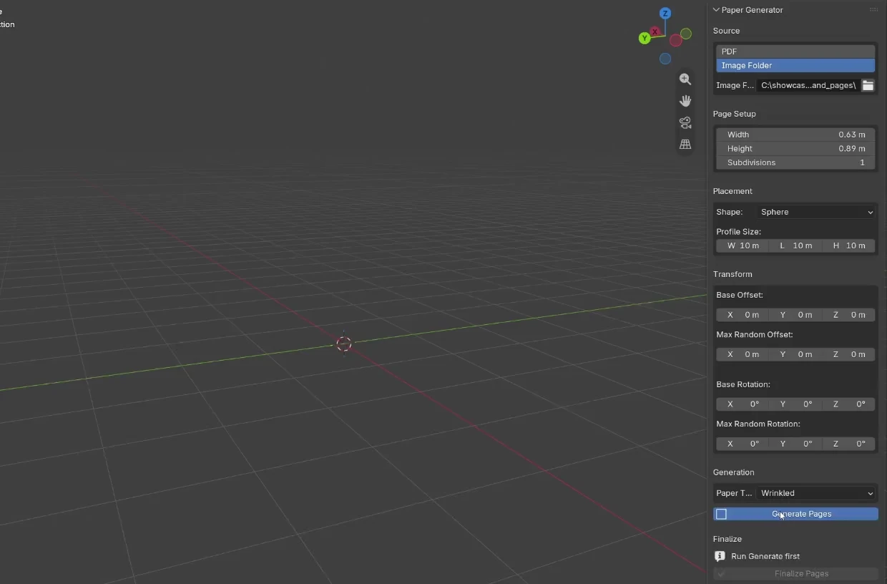

# Paper Generator

A Blender add-on that turns a PDF or a folder of images into real, individual page objects, and arranges them along a curve or scatters them inside a shape.

## Requirements

- Blender 4.5 or newer (last tested on 5.2)
- Internet connection for the one-time PyMuPDF install (PDF mode)

## Installation

1. Download `PaperGenerator.zip` from the [Releases page](https://github.com/BigGuyNickM/Paper-Generator-Blender-Addon/releases).
2. In Blender, open Edit > Preferences, click the dropdown arrow in the top right, and choose Install from Disk.
3. Select the zip and enable the add-on.
4. On first use, click Install Dependencies to install PyMuPDF.

## Usage

Open the sidebar in the 3D viewport (N) and find the Paper Generator tab.

1. Pick a source: PDF or Image Folder. In PDF mode, Blender will freeze briefly while the pages are converted to images in a folder next to the PDF's file location.
2. Set the page size (defaults to A4 proportions).
3. Pick a placement shape. Curve stacks pages along a curve object, and the other shapes scatter pages inside a generated mesh.
4. Adjust offset and rotation for randomness, choose a paper texture, and click Generate.
5. You can keep tweaking offsets and rotations, and edit the curve or shape mesh (TAB on the objects), before finalizing.
6. When you're done, click Finalize to convert everything into real page objects.

## Notes

PyMuPDF is installed separately and is licensed under AGPL. It is not bundled with this add-on.

## License

MIT